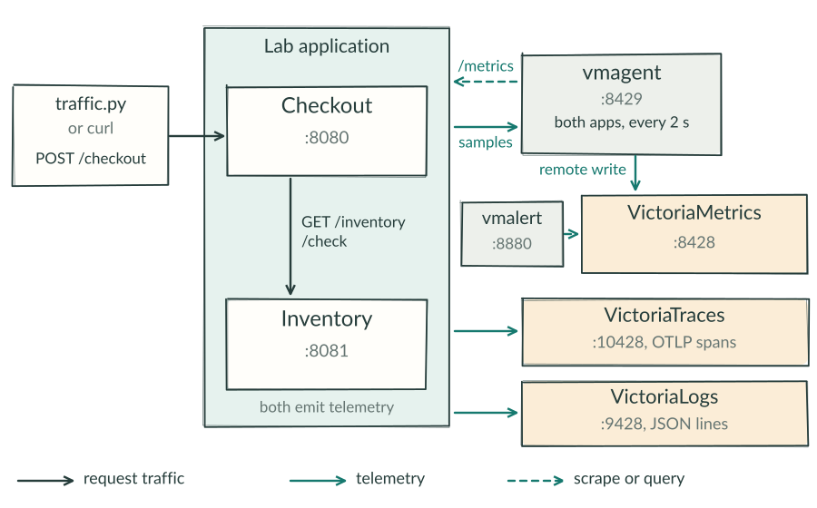

# Beyond the Dashboard: companion repository

This repository goes with *Beyond the Dashboard: A Practical Guide to Observability*. The book is prepared by Saiyam Pathak in collaboration with VictoriaMetrics.

The book explains what metrics, traces, and logs are, has you run and query all three on a laptop, and then follows one slow release from the first graph to the line of code behind it. This repository holds the lab that the book uses, so you can do every step yourself.



## Start the lab

You need git, Python 3.12, and internet access for the first downloads. The lab runs on macOS or Linux, without Docker or Kubernetes.

```sh
git clone https://github.com/kubesimplify/beyond-the-dashboard
cd beyond-the-dashboard/lab
python3.12 setup.py
.venv/bin/python control.py start
```

`setup.py` downloads the pinned release binaries, checks them against the published checksums, and installs the Python packages in `lab/.venv`, so nothing is installed globally. `control.py start` starts seven programs on their default ports, all on 127.0.0.1, and prints the page to open for each one.

| Interface | Address |
| --- | --- |
| VictoriaMetrics (VMUI) | http://127.0.0.1:8428/vmui/ |
| VictoriaLogs | http://127.0.0.1:9428/select/vmui/ |
| VictoriaTraces | http://127.0.0.1:10428/select/vmui/ |
| vmagent scrape targets | http://127.0.0.1:8429/targets |
| vmalert alerts | http://127.0.0.1:8880/vmalert/alerts |

## Follow the book

Send one checkout and keep the trace ID from the reply:

```sh
curl -s -X POST http://127.0.0.1:8080/checkout
```

`traffic.py` plays the part of checkout's customers. Each step switches checkout to a version and sends it 60 checkouts over 30 seconds. Run each one when the book asks for it, not all at once:

```sh
.venv/bin/python traffic.py v1      # Part 2: learn the queries on steady traffic
.venv/bin/python traffic.py v2      # Part 3: a new release, and an investigation
.venv/bin/python traffic.py v2.1    # Part 3: the patch, and the check
```

Wait about 30 seconds after traffic before you query, because VictoriaMetrics and VictoriaTraces hide the newest 30 seconds of data by default. In each interface, set the time range at the top right to cover your traffic, for example, the last 30 minutes.

When you are done:

```sh
.venv/bin/python control.py stop
```

Part 5 (pages 46 to 48) runs the same apps on VictoriaStack, first with Docker and then on a kind cluster. [lab/README.md](lab/README.md) has those steps, every query the book uses, and what was tested.

## What is here

| Path | What it holds |
| --- | --- |
| [lab/](lab/) | The checkout and inventory apps, and the scripts that set up, start, query, and test them |
| [lab/evidence/](lab/evidence/) | The recorded results that the book cites: the run behind Parts 2 to 4, and the runs of Parts 5 and 6 |
| [diagrams/](diagrams/) | The book's diagrams as editable Excalidraw files, each with an SVG copy |
| [SOURCES.md](SOURCES.md) | Every source the book cites, with the claim it supports |

## Tested versions

The book's run was recorded on 16 October 2026 on macOS 27.0.1 (ARM64) with Python 3.12.4.

| Component | Version |
| --- | --- |
| VictoriaMetrics, vmagent, and vmalert | v1.153.0 |
| VictoriaLogs | v1.53.0 |
| VictoriaTraces | v0.12.0 |

A full run also passed on Linux (Ubuntu 24.04, x86_64) on 4 November 2026, and with the lab's own Docker Compose file on 19 November 2026.

## Feedback

If something here does not match the book, or a step does not work for you, please open an issue.
